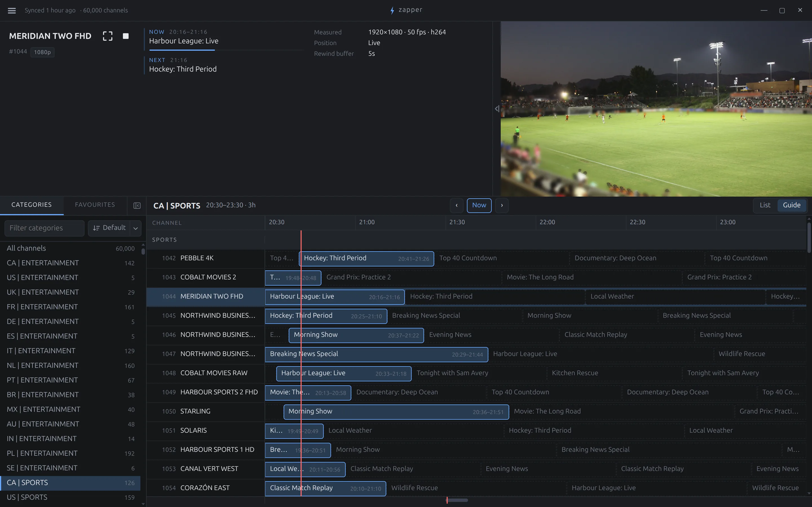
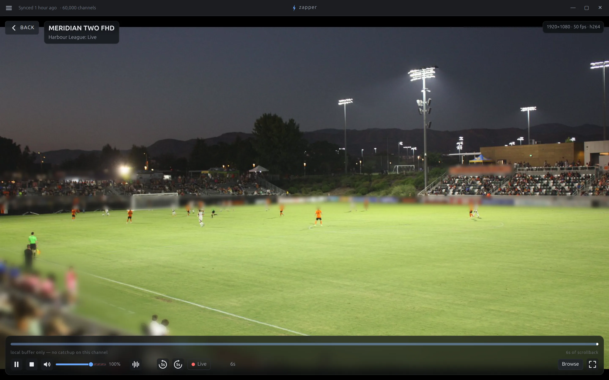

<p align="center">
  
</p>

<h1 align="center">zapper</h1>

<p align="center">A desktop player for live TV from IPTV services, HDHomeRun tuners and Tvheadend.</p>

---

zapper is a desktop player for live TV from Xtream Codes servers, M3U playlists with XMLTV
guides, HDHomeRun tuners and Tvheadend servers. It keeps a local copy of the channel list and
guide, so browsing and searching don't wait on the network, and the current channel keeps
playing in a corner while you browse.

It's built with a Rust core, a React interface and [Tauri](https://tauri.app/), with
[mpv](https://mpv.io/) (libmpv) for playback.



> **Status:** used daily on Linux. Windows is newer and less tried. macOS (Apple Silicon) builds
> and plays in CI but isn't released yet.

## Platforms

| Platform | Status |
|---|---|
| Linux | Supported: `.deb`, `.rpm` and Arch Linux packages |
| Windows | Supported (10 and 11, x64): a setup for you alone or an MSI for the whole computer |
| macOS | Apple Silicon: builds, packages (`.dmg`) and plays in CI; not yet tried on a real Mac or released ([docs/macos.md](docs/macos.md)) |

## Installing

Download the package for your system from the
[latest release](https://github.com/francislavoie/zapper/releases/latest):

- **Debian and Ubuntu:** `sudo apt install ./zapper_<version>_amd64.deb`
- **Fedora:** `sudo dnf install ./zapper-<version>-1.x86_64.rpm`
- **Arch Linux:** `sudo pacman -U ./zapper-<version>-1-x86_64.pkg.tar.zst`
- **Windows:** `zapper_<version>_x64-setup.exe` installs it for you alone, no administrator
  needed (in `%LOCALAPPDATA%\zapper`); `zapper_<version>_x64_en-US.msi` installs it for everyone
  on the computer (in `Program Files`, asking for an administrator). Either carries its own
  libmpv and FFmpeg, and needs WebView2, which Windows 11 has and Windows 10 has had since 2021.

  The installers aren't signed yet, so the first run of one gets a SmartScreen warning ("Windows
  protected your PC"): choose **More info**, then **Run anyway**. Check the file against
  `SHA256SUMS` first (`Get-FileHash .\zapper_<version>_x64-setup.exe` in PowerShell) if you'd
  like to know it's the one the release built.

`SHA256SUMS` in each release lists the files' checksums. After that, zapper updates itself (see
[Updates](#updates)).

## Features

The short list; [docs/features.md](docs/features.md) has how each part behaves.

### Sources

- Xtream Codes: live channels, guide, catch-up, movies and shows.
- M3U playlists (URL or file) with XMLTV guides and catch-up. On-demand entries become movies, or
  episodes when the name has an episode number (`S01E02`, `1x02`, `S01E01-E02`).
- HDHomeRun tuners, with SiliconDust's guide or your own XMLTV.
- Tvheadend servers, with or without a login.
- Export and import of settings, favourites and categories.

### Browsing

- The channel list and guide are kept locally, so browsing and search are instant.
- **Live TV**: a rail with Favourites, Recently watched, Recordings, All channels and your
  categories, each as a list or a guide (`G`). Rows show what's on now and next.
- **Movies** (`M`) and **Shows** (`N`): browse by category as a list or posters, sort, filter by
  year, search, and mark favourites and watched. A show's sheet lists its seasons and episodes.
- Channel search (`/`, `a|b` for either) and programme search across the guide and catch-up.
- Pin, hide and sort categories.
- Each channel's resolution, frame rate and codec; channels that failed are dimmed with the reason.
- The playing channel stays in a docked picture while you browse.
- Command palette (`Ctrl+P`) and a full shortcut list in Settings › Keyboard.

### Playback



- libmpv with hardware decoding and HDR tone-mapping.
- A live rewind buffer, and catch-up where the source has an archive.
- Movies and episodes with a seek bar, resume, and watched past 92 %.
- **Continue watching** (`W`): resume movies and shows where you left off, in the app and the browser.
- **Up next**: a countdown into the next episode, keeping your audio and subtitle languages.
- **Find subtitles** online (OpenSubtitles) for movies and episodes, in the app and the browser.
- `P` for the previous channel; type a number to tune.
- Volume to 200 %, a compressor, track choice, aspect ratio, deinterlacing and a sleep timer.
- A subtitles button (`C`), remembered across channels and restarts.
- Subtitle font, size, colour and backdrop.
- Theater mode (`T`) and stats (`S`).
- A refused or ended stream says why; zapper reconnects on its own only after network failures.
- Optional media keys and desktop media controls.

### Recording

- Record from the guide, or what you're watching (`R`), with zapper closed. Files are named for
  Jellyfin and Plex, with a backup channel if the feed fails.
- Works on a one-connection account: recordings and the player share the connection.
- Conflicts are shown before recording.
- Jellyfin can play a recording while it records.
- On Linux and Windows. See [docs/recording.md](docs/recording.md).

### In a browser

- With network access on, the recording service serves zapper to other devices behind a
  password: live TV, movies, shows, the guide and recordings. The provider's address never
  reaches the browser.

### Other

- Restores the last channel, window size and volume.
- Interface zoom and a 12- or 24-hour clock.
- Updates itself from GitHub releases, checked against their checksums.
- Credentials are readable only by you and kept out of logs.
- No telemetry: apart from your sources, only the daily update check, which can be turned off.

## Performance

Rough numbers, to give a sense of it. Measured on a Framework 13 laptop (Ryzen 7 7840U,
Radeon 780M graphics) on Ubuntu, with a release build, a synthetic 50,000-channel playlist and a
1080p25 H.264 test stream:

| | |
|---|---|
| Start to window and video surface ready | ~0.5 s |
| First import of 50,000 channels | ~0.9 s (catalogue ready ~1.4 s after launch) |
| Searching 50,000 channel names | 2–3.5 ms per query |
| Tune to first frame | ~0.2–0.5 s when the server bursts on connect, as most do; ~1–1.3 s when it sends in real time |
| CPU while playing 1080p | ~11% of one core (hardware decoding) |
| CPU while idle | ~0.1% of one core |
| Memory, all processes (PSS) | ~210 MB idle with 50,000 channels loaded, ~290 MB playing |
| Package size | 7.6 MB `.deb` (libmpv and WebKitGTK come from the system) |

## Updates

zapper checks its GitHub releases a minute after startup and once a day after that. When there's
a newer version, it offers to download the package for how you installed it, keeps the download
only if the release's `SHA256SUMS` lists it with the same digest, and installs it:

- **Linux (`.deb`, `.rpm`, Arch):** through `pkexec`, so your desktop asks for your password.
  The package is copied somewhere only root can write and checked again before apt, dnf,
  zypper, rpm or pacman sees it. If you installed zapper through an AUR helper, update it there
  instead.
- **Windows:** runs the new setup or MSI (the MSI asks for an administrator), after checking it
  again, and quits so it can replace zapper.
- **Restart** then starts the new version.

A build from source only links to the release page. Settings › Updates turns the automatic check
off.

## Building from source

Requirements: a stable Rust toolchain, Node.js 26 (see `.nvmrc`) and npm,
[`just`](https://github.com/casey/just), and the WebKitGTK development packages. On Debian and
Ubuntu:

```sh
sudo apt install libwebkit2gtk-4.1-dev libgtk-3-dev libsoup-3.0-dev \
  libjavascriptcoregtk-4.1-dev librsvg2-dev libxdo-dev libayatana-appindicator3-dev \
  libepoxy-dev pkg-config
```

libmpv isn't one of them: zapper builds against, and its packages carry, its own LGPL build of
libmpv and FFmpeg, which `just fetch-libmpv` downloads into `src-tauri/lib/`
([docs/licensing.md](docs/licensing.md#mpv-and-ffmpeg)). Without it a development build falls
back to the system's (`libmpv-dev`).

Packaging and the release-script checks also want `jq`, `dpkg-dev`, `zstd` (the Arch package)
and `desktop-file-utils`;
the license notices want [`cargo-about`](https://github.com/EmbarkStudios/cargo-about) 0.9.2 and
Python 3; the test streams in `tools/` want Python 3 and `ffmpeg`.

Then:

```sh
npm ci
just fetch-libmpv  # the bundled libmpv, into src-tauri/lib/
just dev           # run a development build
just test          # Rust, interface and release-script checks
just package       # build the .deb and .rpm
just licenses      # regenerate the third-party license notices
```

[docs/windows.md](docs/windows.md) covers building on Windows, [docs/macos.md](docs/macos.md)
on macOS, and [docs/releasing.md](docs/releasing.md) cutting a release.

## Documentation

- [docs/features.md](docs/features.md): how each feature behaves, in detail
- [docs/recording.md](docs/recording.md): the recording service, its settings and its API
- [docs/releasing.md](docs/releasing.md): versions, packages, releases and the updater
- [docs/windows.md](docs/windows.md): building and running on Windows
- [docs/macos.md](docs/macos.md): building on macOS, what CI checks there, and what still needs a
  real Mac
- [docs/licensing.md](docs/licensing.md): how third-party licenses are collected and shipped
- [tools/README.md](tools/README.md): test fixtures and development tools

## License

[MIT](LICENSE). zapper's packages carry libmpv and, inside it, FFmpeg, built without their GPL
parts and so under the LGPL; see [docs/licensing.md](docs/licensing.md) for what is in it and
where its source is.

zapper is a player. It doesn't provide any channels or content: bring your own tuner, server or
playlist, and use it with content you're entitled to watch.
